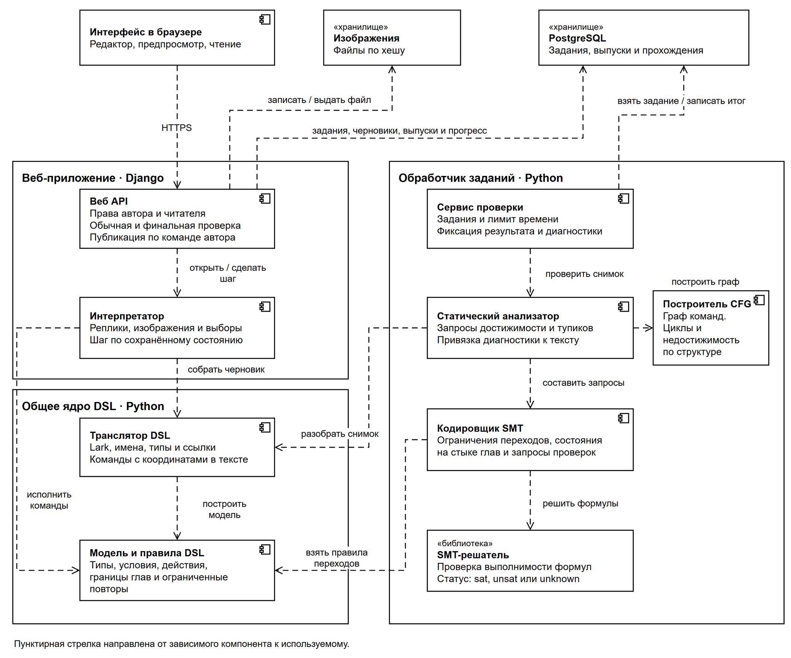
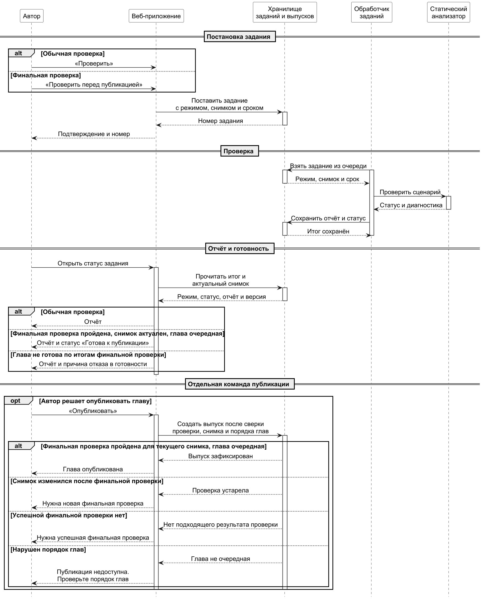
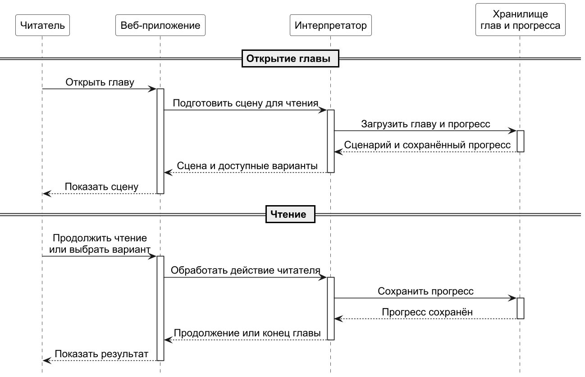
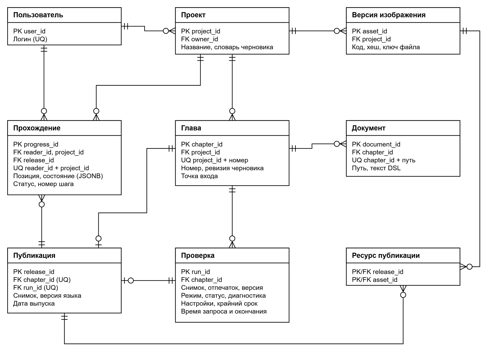
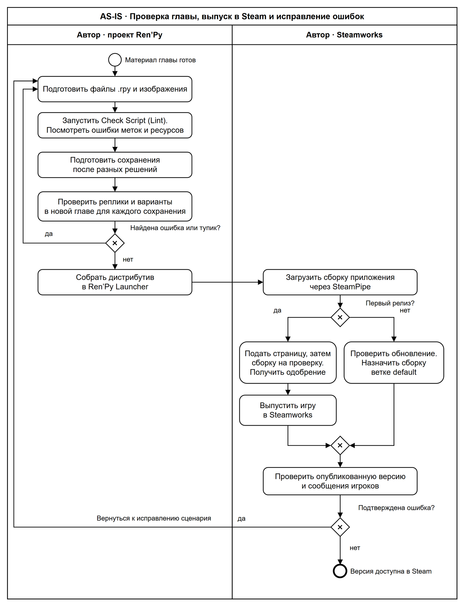
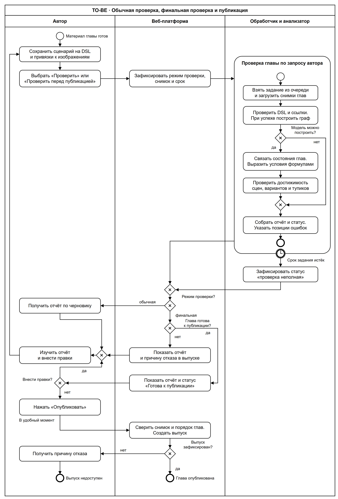

# ЛР 3 — проектирование

**Тема ВКР:** Разработка платформы для создания визуальных новелл на основе предметно-ориентированного языка сценариев с автоматическим анализом целостности сюжета.

**Автор:** Борисевич Анна Валериевна, Университет ИТМО, группа K3423.

**Формат работы:** индивидуальный проект.

## 1. Предметная область и требования

### Описание предметной области

Автор визуальной новеллы пишет сцены и диалоги, подбирает фоны и спрайты, задаёт варианты выбора и их последствия. Решения читателя меняют характеристики и сюжетные флаги, от которых зависит доступность сцен и вариантов в следующих главах. Перед выпуском автору нужно проверить, сможет ли читатель продолжить историю из каждого достижимого состояния.

Проектируемая веб-платформа объединяет текстовый редактор, статический анализатор и проигрыватель. Автор без опыта программирования создаёт новеллу в браузере, загружает изображения и записывает историю на предметно-ориентированном языке (DSL). Платформа связывает реплики с персонажами, подставляет фон и спрайты, показывает доступные выборы и сохраняет их последствия. Автор просматривает черновик, проверяет сценарий в редакторе, а перед выпуском запускает финальную проверку. Готовую главу он публикует в выбранный момент. Читатель открывает новеллу на витрине и продолжает чтение с сохранённого места. Один человек может вести собственный проект и читать чужие.

**Предмет проверки** — сценарий новой главы, его ресурсы и все ранее выпущенные главы той же новеллы. Анализатор проверяет синтаксис, ссылки, типы и структуру переходов. Для проверки условий используется SMT (Satisfiability Modulo Theories, проверка выполнимости формул в заданных теориях). Анализатор определяет достижимость сцен, вариантов и концовок и ищет состояния, в которых закрыты все выходы.

### Функциональные требования

| ID | Требование | Как проверить выполнение |
|---|---|---|
| FR-01 | Платформа должна позволять автору зарегистрироваться, войти, создать проект и главу, сохранить текст сценария и словарь персонажей с псевдонимами. | **Ручной тест.** Зарегистрироваться и войти. Создать проект, сохранить главу и словарь. В новой сессии открыть проект и сверить сохранённые данные. |
| FR-02 | Автор может загрузить фон и связать готовый спрайт с персонажем, внешностью, нарядом и эмоцией. Платформа должна выбирать спрайт по этой комбинации. | **Ручной тест.** Загрузить фон и спрайты. При смене заданной комбинации проверить, что проигрыватель показывает подходящие изображения. |
| FR-03 | Транслятор должен преобразовывать корректный текст DSL в типизированные команды, разрешать имена и ссылки в пределах проекта и диагностировать ошибки синтаксиса, типов, неоднозначных имён и отсутствующих объектов. | **Автотест.** Для корректного текста сверить команды и разрешённые ссылки. Для ошибок, включая отсутствующую привязку спрайта и ссылку на отсутствующий файл, сверить коды и позиции диагностик. |
| FR-04 | Анализатор должен обнаруживать запрещённые циклы между сценами и сцены, к которым не ведёт ни один путь по графу сценария. | **Автотест.** Проверить граф с циклом и граф со структурно изолированной сценой. Ожидать критическую ошибку цикла и предупреждение об изолированной сцене. |
| FR-05 | Анализатор должен проверять достижимость сцен, выборов и концовок с учётом совместных значений показателей, флагов и перечислений. Если в достижимом состоянии нет допустимого перехода или явного завершения, анализатор должен отметить позицию тупика как критическую ошибку. | **Автотест.** Сверить достижимость ветвей при выполнимых и невыполнимых условиях. Для тупиков с отсутствующими или закрытыми выходами проверить код, критический уровень и позицию ошибки. |
| FR-06 | Платформа должна исполнять и проверять повторяющееся меню выбора внутри сцены в двух режимах. В первом выбранный пункт исчезает из меню. Во втором один пункт можно выбирать повторно, пока читатель не исчерпает заданный автором лимит выборов. | **Автотест.** В первом режиме проверить, что выбранный пункт больше недоступен, а во втором — что он доступен повторно до исчерпания лимита. Сверить правила проигрывателя и анализатора, проверить досрочный выход и отклонение недопустимых лимитов и вложенных повторов. |
| FR-07 | При проверке новой главы анализатор должен учитывать все сочетания значений характеристик, флагов и других параметров, с которыми читатель может закончить предыдущую главу на отметке «Продолжение следует». Ветви с отметкой «Финал» завершают прохождение. | **Автотест.** Проверить условие новой главы при разных значениях, накопленных в предыдущей. Проверить, что значения ветвей с отметкой «Продолжение следует» учитываются на входе новой главы, а ветви с отметкой «Финал» туда не переходят. |
| FR-08 | Автор должен иметь возможность в любой момент запустить проверку сохранённого черновика кнопкой «Проверить» и получить отчёт. Диагностика содержит уровень, причину и, если позиция определима, ссылку на неё в сценарии. | **Ручной тест.** Сохранить черновик с ошибкой и убедиться, что задание создаётся только после нажатия «Проверить». Сверить причину и уровень ошибки, перейти к указанной позиции. После исправления повторить проверку и убедиться, что замечание снято. |
| FR-09 | Автор может пройти выбранную ветвь черновика в предпросмотре, увидеть реплики, фоны, спрайты и последствия выбора до выпуска главы. | **Ручной тест.** Пройти ветвь в предпросмотре, сверить показанные ресурсы и последствия выбора. Проверить, что читательское сохранение не изменилось. |
| FR-10 | Перед публикацией автор должен запустить финальную проверку кнопкой «Проверить перед публикацией». Статус «Готова к публикации» получает только очередная глава с актуальным снимком и полной финальной проверкой без критических ошибок. Глава публикуется по отдельной команде «Опубликовать» после повторной сверки финальной проверки, снимка и порядка глав. | **Автотест.** Выполнить только обычную проверку. Убедиться, что платформа выдаёт отчёт и отклоняет команду публикации. Завершить финальную проверку с предупреждением и проверить появление готовности без выпуска. Позднее отправить команду «Опубликовать» и проверить создание выпуска для того же снимка. Проверить отказы при изменении снимка, нарушении порядка, критической ошибке или неполной финальной проверке. |
| FR-11 | Читатель может открыть опубликованную новеллу из витрины, увидеть допустимые варианты и перейти по выбранной ветви. В конце ветви проигрыватель должен различать ожидание продолжения и окончательный финал истории. | **Ручной тест.** Открыть опубликованную новеллу, проверить доступность вариантов, переходы и состояния окончания. Убедиться, что черновики недоступны для чтения. |
| FR-12 | Платформа должна сохранять прогресс прохождения, одно активное прохождение на пару «читатель — новелла»; восстанавливать его после входа, продолжать после выхода новой главы и сбрасывать по команде читателя. | **Автотест.** Восстановить сохранение, продолжить после выхода главы и сверить перенесённое состояние. После сброса проверить начальную позицию и значения. |

### Нефункциональные требования

| ID | Требование | Как проверить выполнение |
|---|---|---|
| NFR-01 | Не позднее чем через **5 минут (300 с)** после регистрации задания на проверку веб API должен возвращать итог или статус «проверка неполная». Настраиваемый срок включает очередь, анализ и фиксацию результата. Готовность по завершённой в срок финальной проверке действует, пока снимок актуален и глава остаётся очередной. | **Автотест времени.** Смоделировать истечение срока в очереди и во время анализа. Проверить причину неполной проверки и отклонение запоздавшего результата. Для успешной финальной проверки без последующих правок убедиться, что готовность сохраняется после окончания срока задания. |
| NFR-02 | Если анализатор не смог проверить достижимость или наличие тупиков в какой-либо части сценария, платформа должна показать статус «Проверка неполная» и указать в отчёте, что именно осталось непроверенным. Такая финальная проверка не даёт главе статуса «Готова к публикации». | **Автотест.** Смоделировать ситуацию, в которой анализатор не смог выяснить, можно ли дойти до одной из сцен. Проверить, что эта сцена указана в отчёте, проверка отмечена как неполная, а команда публикации отклоняется. |
| NFR-03 | Читать и менять приватный черновик, открывать предпросмотр и запрашивать выпуск может только владелец проекта. Читатель получает только опубликованные ресурсы и своё сохранение. | **Автотест доступа.** Проверить разрешённые и запрещённые операции гостя, владельца и другого пользователя. Запрещённые запросы не раскрывают данные и не меняют записи. |
| NFR-04 | Выпуск должен атомарно фиксировать проверенные текст, определения, версии изображений и версию языка. У главы может быть только один неизменяемый выпуск. Повтор одного читательского шага не должен повторно менять состояние. | **Интеграционный автотест.** Проверить параллельные выпуски, правку черновика до фиксации и сбой записи. Ожидать один выпуск, отказ устаревшему запросу и отсутствие частичной публикации соответственно. Повторить запрос выбора с прежним номером шага и сверить состояние. |
| NFR-05 | Анализатор, предпросмотр и чтение должны применять правила одной версии DSL. Для одинаковых снимка, версии анализатора и настроек полные проверки должны давать одинаковый набор кодов, уровней и позиций диагностик. | **Автотест соответствия.** Сверить достижимость и позиции тупиков с результатами независимого перебора в проигрывателе. Сравнить диагностику двух полных проверок с одинаковыми входами. |
| NFR-06 | Сценарий должен исполняться только через разрешённые операции DSL. Текст выводится с экранированием. Для графики допускаются декодируемые PNG и JPEG в пределах заданного размера. | **Автотест обработки ввода.** Проверить отклонение недопустимых команд и некорректных загрузок, отображение разметки как текста и приём допустимых изображений. |

## 2. Обзор нотаций и видов диаграмм

| Нотация или вид диаграммы | Что описывает | Сильные стороны |
|---|---|---|
| BPMN (Business Process Model and Notation) | Задачи участников процесса, их порядок, события и развилки | По дорожкам видно, кто выполняет проверку и кому возвращается работа при отказе. |
| IDEF0 | Функцию, её входы, выходы, управляющие условия и механизмы выполнения | Отделяет текст, поступающий на проверку, от правил языка, по которым его проверяют. |
| DFD (Data Flow Diagram) | Потоки данных между процессами, хранилищами и внешними участниками | Показывает, откуда приходят исходные файлы и кто получает результат анализа. |
| ER-модель (Entity–Relationship), Crow’s Foot | Сущности, ключи, обязательность и кратность связей | Выражает различие между главой, несколькими проверками и единственным выпуском. |
| UML — диаграмма вариантов использования | Цели участников и доступные им функции | Помогает разграничить действия автора и читателя, даже когда это один пользователь. |
| UML — диаграмма последовательности | Сообщения между участниками одного сценария во времени | Показывает, в какой момент проверяется версия и что происходит при отказе. |
| UML — диаграмма состояний | Допустимые состояния объекта и события перехода | Удобна для проверки жизненного цикла задания или читательского прохождения. |
| UML — диаграмма компонентов | Программные модули, их интерфейсы и зависимости | Позволяет отделить парсер и интерпретатор от HTTP-запросов и базы данных. |
| C4 — диаграмма контейнеров | Приложения и хранилища внутри границы системы, их обязанности и связи | Показывает, где выполняется длительная проверка и каким путём её результат попадает в редактор. |


## 3. Выбор нотаций для проекта

| Нотация или вид диаграммы | Что моделируем | Связанные требования | Почему подходит |
|---|---|---|---|
| BPMN | Подготовка, проверка и выпуск главы в AS-IS и TO-BE | FR-03–FR-08, FR-10, NFR-01, NFR-02, NFR-04 | Дорожки распределяют работу. Шлюзы и таймер показывают, на каких условиях выпуск продолжается или возвращается автору. |
| UML, компоненты | Веб-приложение, обработчик заданий, общее ядро DSL и модули SMT-проверки | FR-01–FR-06, FR-09, FR-11, NFR-01–NFR-03, NFR-05, NFR-06 | Зависимости показывают, кто строит граф и формулы, где выполняется анализ и откуда проигрыватель получает правила языка. |
| UML, последовательность | Постановка задания, выпуск и чтение главы | FR-08, FR-10–FR-12, NFR-01, NFR-04 | Ответы показывают, когда доступен отчёт, как публикуется актуальный снимок и когда сохраняется прогресс чтения. |
| ER, Crow’s Foot | Владение проектом, состав главы, проверенный снимок, графика и прохождение | FR-01, FR-02, FR-08, FR-10, FR-12, NFR-03–NFR-05 | Ключи и кратности связывают сохранение читателя с выпуском, а выпуск — с проверкой и версиями ресурсов. |

## 4. Модели системы

### 4.1. Архитектура платформы — UML, диаграмма компонентов



*Рисунок 1. Компоненты платформы и зависимости анализатора.*

Веб-приложение Django и обработчик заданий запускаются на одном сервере Linux и используют общую библиотеку DSL. При запросе проверки веб API проверяет доступ, сохраняет режим и снимок, ставит задание в PostgreSQL и возвращает его номер. Обработчик передаёт снимок анализатору, следит за сроком и записывает результат. Веб API показывает отчёт и определяет готовность по результату финальной проверки. По отдельной команде «Опубликовать» приложение сверяет готовность и актуальность снимка и фиксирует выпуск в транзакции (FR-08, FR-10, NFR-01, NFR-03, NFR-04).

Транслятор выдаёт типизированные команды с координатами в исходном тексте. Построитель графа потока управления (CFG) выделяет ветвления и границы глав. Кодировщик переводит граф и правила DSL в SMT-формулы. Решатель сообщает статус выполнимости запроса. Анализатор связывает диагностику с позицией проверяемой команды. Конкретный решатель выбирается при реализации по результатам испытаний (FR-03–FR-09, NFR-02, NFR-05).

Текст, словарь и прохождения хранятся в PostgreSQL. Веб API декодирует изображения при загрузке, проверяет доступ при выдаче и хранит файлы под ключами, зависящими от содержимого. Для изменения данных используются аутентифицированная сессия и защита от межсайтовой подделки запросов. Исходный сценарий обрабатывается по фиксированной грамматике, реплики выводятся как текст (FR-02, FR-11, FR-12, NFR-03, NFR-06).

### 4.2. Проверка сценария и выпуск главы — UML, диаграмма последовательности



*Рисунок 2. Два режима проверки и публикация по команде автора.*

- **«Проверить».** Обычная проверка черновика даёт отчёт. Если предыдущие главы ещё не выпущены, в нём указано, какие проверки между главами пока невозможно выполнить (FR-07, FR-08).
- **«Проверить перед публикацией».** Тот же анализатор проверяет сценарий, а платформа дополнительно сверяет полноту результата, актуальность снимка и порядок глав. Полная финальная проверка без критических ошибок даёт очередной главе статус «Готова к публикации». Предупреждения остаются в отчёте и допускают выпуск (FR-10).
- **«Опубликовать».** Автор отправляет отдельную команду, когда решает выпустить готовую главу. Платформа требует успешную финальную проверку текущего снимка и сверяет порядок глав. Одной обычной проверки для выпуска недостаточно. Если автор изменил снимок после финальной проверки, платформа отклоняет публикацию и предлагает повторить финальную проверку (FR-10, NFR-04).

**Разбор и проверка ресурсов.** При запросе фиксируются тексты главы, словарь, версии изображений, версия языка и список предшествующих выпусков. Парсер Lark разбирает текст в абстрактное синтаксическое дерево (AST). Транслятор разрешает идентификаторы и типы, формирует исполняемые команды и сохраняет для каждой команды файл, строку и столбец. На этом же этапе проверяются ссылки на фоны и словарь спрайтов. Для каждого объявленного варианта оформления транслятор ищет привязку по ключу «персонаж, внешность, наряд, эмоция» и проверяет наличие файла указанной версии. Пропущенная привязка или отсутствующий файл дают критическую ошибку с указанием проблемной записи. Неустранимая ошибка разбора останавливает последующие стадии для этого фрагмента (FR-02, FR-03, FR-08).

**Эскиз синтаксиса DSL.** Сцены, варианты выбора и явные завершения записываются в одном документе. Идентификаторы параметров и сцен разрешаются при трансляции.

```text
# Начальная_сцена
* Продолжить [показатель += 1] -> Следующая_сцена
* Завершить -> Финальная_сцена

# Следующая_сцена
-> Продолжение следует

# Финальная_сцена
-> Финал
```

**Граф сценария.** Из типизированных команд строится граф ветвлений и переходов. Структурный обход находит изолированные сцены, а проверка циклов выявляет запрещённые возвраты между сценами. Для локального повтора граф разворачивается по числу итераций. Повтор с исключением хранит флаг для каждого уже выбранного пункта, поэтому разные порядки ответов представляются условиями над этими флагами. Выход по исчерпанию вариантов и досрочный выход кодируются по правилам проигрывателя (FR-04, FR-06).

**SMT-модель.** После развёртки ограниченных повторов максимальное число шагов вычисляется по длине самого длинного пути в ациклическом графе. На каждом шаге модель хранит позицию в сценарии, целочисленные показатели, флаги и значения перечислений. У каждого перехода есть условие доступности и формула, связывающая прежнее состояние с новым. Неизменяемые переходом значения сохраняются. Переменная длины префикса указывает, сколько шагов действительно сделано. Запрос ограничен шагами этого префикса, поэтому может проверить и позицию без доступного продолжения. Для разных проверок используется общий набор ограничений и отдельное условие запроса (FR-04–FR-06).

В ЛР 2 рассматривался интервальный анализ. SMT позволяет учитывать связи между показателями после слияния ветвей. Если два значения достижимы по отдельности на разных путях, анализатор проверяет, могут ли они встретиться вместе в состоянии, от которого зависит выбор (FR-05).

**Границы глав.** Анализатор строит общую модель по опубликованным главам и главе, которую автор проверяет. На отметке «Продолжение следует» состояние связывается с точкой входа следующей главы. Значения существующих параметров сохраняются. Для новых применяются начальные значения версии главы. На последней доступной главе эта отметка означает ожидание. Явный финал завершает свою ветвь (FR-07, FR-10).

**SMT-запросы и диагностика.**

| Свойство | Что запрашивает анализатор | Как обрабатывается ответ |
|---|---|---|
| Достижимость сцены, выбора или концовки | Существует ли префикс до нужной позиции, на котором выполнено условие варианта? | `sat` подтверждает достижимость. `unsat` даёт предупреждение о недостижимом фрагменте. |
| Тупик | Существует ли достижимое нетерминальное состояние, в котором отсутствуют переходы или ложны условия всех исходящих переходов? | `sat` даёт критическую ошибку с позицией и причиной. `unsat` исключает такой тупик. |

Ответ решателя `unknown` означает, что он не смог установить выполнимость формулы. Анализатор помечает соответствующую проверку сценария как незавершённую и добавляет её в отчёт вместе с уже полученными результатами. Критические ошибки и неполная финальная проверка препятствуют выпуску (FR-08, FR-10, NFR-01, NFR-02).

**Время проверки.** Пять минут — предварительный верхний предел на случай тяжёлого запроса или задержки в очереди. Время типовой проверки предстоит измерить на прототипе. В задании хранится абсолютный срок. Обработчик проверяет его перед запуском и перед каждым вызовом решателя, оставляя время на запись результата. По истечении срока веб API выдаёт статус «проверка неполная» для незавершённого задания. Обработчик прекращает просроченное вычисление. При публикации учитывается, что проверка завершилась в свой срок. Готовую главу можно опубликовать позже, пока снимок актуален и порядок глав соблюдён (NFR-01, FR-10).

**План испытаний.** Контрольный корпус включает линейные и ветвящиеся истории, слияния ветвей, локальные повторы и переходы между главами. Для малых историй результаты анализа сверяются с независимым перебором маршрутов. На более сложных входах измеряются размер модели, число запросов, полное время, время работы решателя и доля неполных проверок. По замерам можно пересмотреть пятиминутный срок и решить, нужны ли дополнительные ограничения (NFR-01, NFR-02, NFR-05).

### 4.3. Чтение главы — UML, диаграмма последовательности



*Рисунок 3. Чтение главы и сохранение прогресса.*

При открытии главы проигрыватель загружает сценарий и прогресс читателя. Он показывает сцену с начала главы или с сохранённой позиции. Читатель переходит к следующей реплике либо выбирает вариант. Платформа сохраняет новую позицию и изменения характеристик, затем показывает продолжение или конец главы (FR-11, FR-12).

Проигрыватель определяет доступные варианты по прогрессу читателя и правилам DSL, которые использует анализатор. В предпросмотре автор читает черновик со своим временным прогрессом (FR-05, FR-06, FR-09, NFR-05).

### 4.4. Модель данных — ER, нотация Crow’s Foot



*Рисунок 4. Связи между авторским черновиком, выпуском и сохранением читателя.*

У проекта один владелец. Главу идентифицирует уникальная пара «проект, номер». Сценарный документ получает уникальный внутри главы виртуальный путь. Для первого прототипа достаточно одного документа на главу. При нескольких документах ссылка «путь + сцена» разрешается в пределах проверяемой главы. Персонажи, псевдонимы, параметры и привязки спрайтов входят в словарь проекта. AST, граф и SMT-формулы строятся на время проверки. В отчёте сохраняются результаты проверки свойств и диагностические сообщения (FR-01–FR-08).

Проверок у главы может быть несколько. Запись проверки хранит режим, снимок, отпечаток, версию анализатора, настройки, срок, время завершения и диагностику. Снимок содержит документы и словарь главы, версии ресурсов и ссылки на предыдущие выпуски. Готовность вычисляется по записям финальной проверки. Изменение проверенного текста, словаря, привязок ресурсов или состава предыдущих выпусков требует новой финальной проверки для выпуска (FR-08, FR-10, NFR-01, NFR-05).

При команде «Опубликовать» веб-приложение в одной транзакции блокирует проект, сверяет порядок глав и отпечаток текущего снимка и ищет для него полную финальную проверку без критических ошибок, завершённую в срок. При совпадении оно использует результат этой проверки. Выпуск хранит исполняемое представление и версию языка, ссылается на разрешившую финальную проверку. Таблица «Ресурс публикации» фиксирует версии файлов. Правки тех же данных используют блокировку проекта. Ограничение уникальности и неизменяемый снимок защищают выпуски, к которым привязаны сохранения (FR-10, NFR-04).

Для пары «читатель, проект» разрешена одна запись прохождения. Её выпуск должен принадлежать этому проекту. Позиция указывает на команду конкретного снимка. Тип состояния и номер шага сохраняются вместе со значениями в формате JSONB — структурированном поле PostgreSQL. Номер шага нужен, чтобы повторная отправка уже выполненного выбора не меняла состояние второй раз. Значения из сохранения переносятся при продолжении в следующей главе. Состояние читателя хранится отдельно от временного состояния предпросмотра и от отчёта анализатора (FR-07, FR-09, FR-11, FR-12, NFR-04, NFR-05).

### 4.5. Связь требований с элементами моделей

| Требования | Где отражены |
|---|---|
| FR-01, FR-02, NFR-03, NFR-06 | Веб API и хранилище изображений на рис. 1. Связи «Пользователь — Проект — Глава» и «Проект — Версия изображения» на рис. 4. |
| FR-03, FR-04 | Транслятор DSL и построитель CFG на рис. 1. Задача разбора и шлюз «Модель можно построить?» на рис. 6. |
| FR-05, FR-06, FR-07, NFR-05 | Общее ядро DSL и кодировщик SMT на рис. 1. Достижимость и связь состояний между главами на рис. 6. |
| FR-08, NFR-01, NFR-02 | Номер задания, отчёт и статус на рис. 2. Крайний срок в сущности «Проверка» на рис. 4. Таймер и показ причины, по которой выпуск недоступен, на рис. 6. |
| FR-09, FR-11, FR-12 | Интерпретатор и предпросмотр на рис. 1. Чтение главы и сохранение прогресса на рис. 3. Уникальная пара «читатель — проект» на рис. 4. |
| FR-10, NFR-04 | Финальная проверка, готовность и отдельная команда публикации на рис. 2 и 6. Связь выпуска с проверкой и поля прохождения на рис. 4. |

## 5. AS-IS и TO-BE

**Выбранная нотация** — BPMN. Обе схемы описывают подготовку и выпуск произвольной главы, включая проверку влияния решений из ранее выпущенных глав. Окружность обозначает событие, скруглённый прямоугольник — задачу, ромб с крестом — исключающий шлюз. Таймер с двойным сплошным контуром на границе подпроцесса обозначает прерывание при истечении срока.

### AS-IS — подготовка в Ren’Py и публикация в Steam



*Рисунок 5. Проверка сценария в Ren’Py, выпуск и исправление ошибок после релиза.*

Автор редактирует файлы `.rpy` и запускает **Check Script (Lint)**. Lint выявляет некоторые ошибки сценария, например переходы на несуществующие метки и ссылки на необъявленные изображения. В Ren’Py также можно написать автотесты, которые выполняют заданные автором действия и проверяют ожидаемый результат. [Исходный код Lint](https://github.com/renpy/renpy/blob/master/renpy/lint.py) · [Ren’Py — автотесты](https://www.renpy.org/doc/html/testcases.html)

На рис. 5 показан ручной вариант проверки. Автор загружает сохранения, сделанные после разных решений в предыдущей главе, и проверяет, что в новой главе появляются подходящие реплики и варианты выбора. После исправлений автор собирает дистрибутив через **Build Distributions**. [Ren’Py — проверка сценария и сборка](https://www.renpy.org/doc/html/quickstart.html#releasing-your-game)

В Steam **можно выпускать историю по частям**. Для первого релиза автор оформляет страницу магазина, загружает сборку, передаёт страницу и затем сборку на проверку Valve. После одобрения и выполнения условий запуска автор выпускает игру. Для следующей главы в рассматриваемом сценарии он обновляет файлы того же приложения, загружает сборку через SteamPipe, тестирует её и назначает основной ветке `default`. Создавать отдельную игру на каждую главу не требуется. Steam доставляет выбранную сборку. За соответствие сюжетных условий состояниям из прежней главы отвечает разработчик новеллы. [Steamworks — первый релиз](https://partner.steamgames.com/doc/store/releasing) · [Steamworks — обновление игры](https://partner.steamgames.com/doc/store/updates)

Ошибка может обнаружиться после релиза на ветви, которую автор не проверил. Если автор подтверждает проблему в опубликованной версии, он возвращается к сценарию в Ren’Py, вносит исправление, повторяет проверку и тестирование и собирает новую версию. В Steamworks она выходит как обновление существующей игры.

### TO-BE — публикация по главам внутри веб-платформы



*Рисунок 6. Проверка межглавных условий и выпуск готовой главы по команде автора.*

Автор выбирает обычную или финальную проверку. Анализатор разбирает сценарий, строит граф, связывает состояния между главами и проверяет достижимость и тупики. При ошибке разбора или запрещённом цикле он возвращает диагностику. Если истекает срок, граничный таймер прерывает подпроцесс, а платформа показывает статус «проверка неполная». После обычной проверки или финальной проверки, по итогам которой глава ещё не готова к выпуску, автор изучает отчёт, вносит правки и возвращается к сохранению сценария (FR-03–FR-08, NFR-01, NFR-02).

После успешной финальной проверки очередной главы платформа показывает отчёт и статус «Готова к публикации». Автор может вернуться к правкам по той же ветви или оставить главу готовой и опубликовать её позднее. Выпуск начинается по команде «Опубликовать». В этот момент платформа сверяет снимок и порядок глав. Для актуального снимка она использует сохранённый результат финальной проверки. При расхождении сообщает причину отказа, и автор запускает новую финальную проверку после устранения причины (FR-10, NFR-04).

### Обоснование перехода

| Что меняется | Где видно в AS-IS, рис. 5 | Где видно в TO-BE, рис. 6 | Проверяемый результат |
|---|---|---|---|
| Проверка условий на стыке глав | Автор проверяет реплики и варианты в новой главе на выбранных сохранениях | Анализатор проверяет, какие состояния достижимы и для каких из них отсутствует продолжение | Анализатор обнаруживает тупик для достижимого состояния, даже если автор не проходил соответствующую ветвь (FR-05, FR-07). |
| Поиск причины отказа | Автор воспроизводит проблему на подходящем сохранении | Платформа показывает позицию и причину тупика | Автор переходит к проблемной позиции, исправляет сценарий и запускает повторную проверку (FR-05, FR-08). |
| Незавершённая проверка | Автор сам решает, когда проверено достаточно ветвей | Таймер прерывает проверку при истечении срока. Отчёт перечисляет незавершённые проверки | Неполная финальная проверка оставляет главу без статуса готовности и объясняет автору причину (NFR-01, NFR-02). |
| Единица и момент выпуска | Автор собирает и загружает приложение, затем вводит сборку в действие | Автор подтверждает готовность главы финальной проверкой и публикует её отдельной командой в выбранный момент | Обычная проверка даёт отчёт. Готовая глава появляется у читателя после команды автора (FR-08, FR-10–FR-12). |

## 6. Обоснование и выводы

1. **Выбор нотаций.** BPMN показывает, какие шаги подготовки, проверки и выпуска главы выполняет автор, а какие берёт на себя платформа. Диаграмма компонентов UML раскрывает устройство анализатора и его связь с проигрывателем через общие правила DSL. Диаграммы последовательности показывают порядок запросов и ответов при проверке, публикации и чтении. ER-модель связывает главы, проверки, выпуски и сохранения читателей.
2. **Отражение требований в моделях.** Транслятор, граф сценария и SMT-проверка отражают разбор DSL, анализ достижимости и поиск тупиков с учётом предыдущих глав (рис. 1 и 6, FR-03–FR-07). Оба режима проверки дают отчёт (рис. 2), по которому автор может вернуться к правкам (рис. 6). Успешная финальная проверка даёт готовность к выпуску, который автор запускает отдельной командой (FR-08, FR-10). Таймер и ветвь отказа на рис. 6 показывают, как обрабатывается неполная проверка, а связь публикации с проверенным снимком на рис. 4 позволяет зафиксировать именно проверенную версию (NFR-01, NFR-02, NFR-04).
3. **Выигрыш для автора и читателя.** При ручной проверке (рис. 5) автор видит только те ветви, которые прошёл сам. В его сохранении (сохраненном состоянии прохождения) в новой главе может быть доступен выбор, а у читателя, принявшего другие решения в предыдущей главе, все варианты окажутся закрыты. В TO-BE (рис. 6) анализатор ищет такие тупики с учётом всех сочетаний характеристик и флагов, с которыми читатель может перейти в новую главу. Автору не нужно готовить сохранение для каждого случая: если найден тупик, отчёт указывает проблемное место в сценарии. Автор может исправить его до выпуска, а не после жалобы читателя. Если финальная проверка осталась неполной, платформа сообщает, что не удалось проверить, и не разрешает публикацию.
4. **Согласованность процесса, данных и взаимодействий.** Задание проверки хранит снимок главы. При публикации сервер сверяет его с текущей версией и связывает выпуск с успешной финальной проверкой. Проигрыватель использует этот выпуск и переносит значения из сохранения читателя по тем же правилам DSL, которые использовал анализатор. Испытания прототипа должны подтвердить согласованность этих правил и показать, как часто проверка укладывается в пятиминутный срок.
